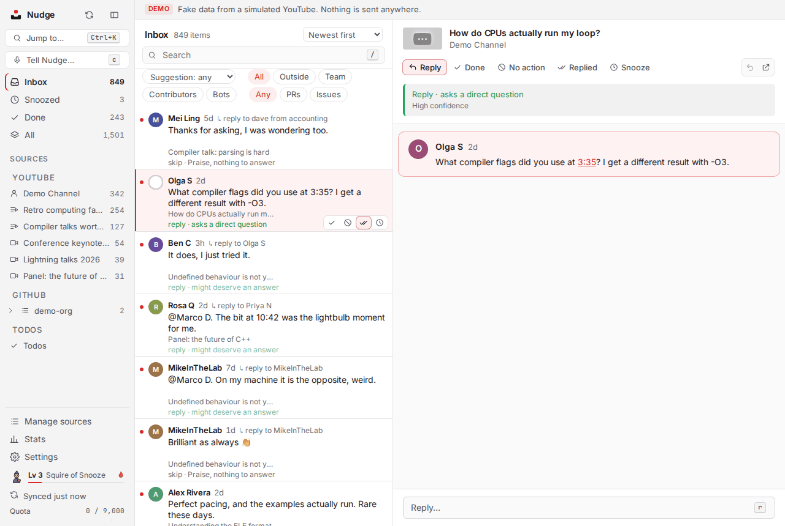
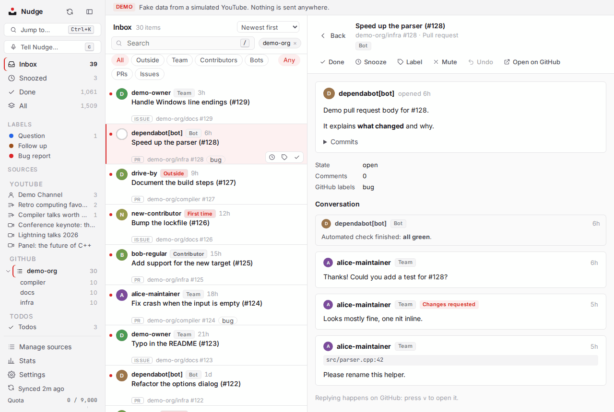
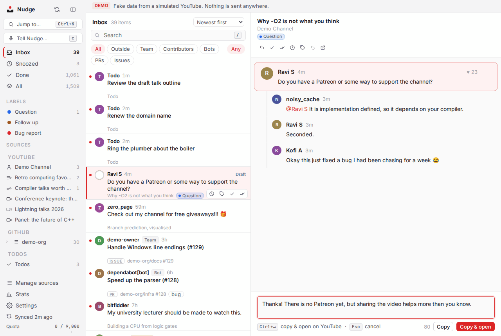
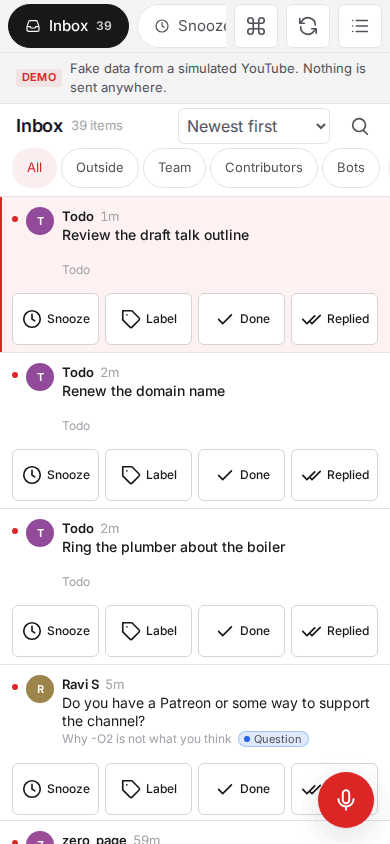

# Nudge

A local, keyboard-driven triage inbox. It pulls in the comments on your YouTube videos (and on videos you merely
appear in), new pull requests and issues from GitHub accounts and organisations you follow, and your own todos, so
all of them are cleared the same way: read, reply, snooze, done.

Nudge is a personal tool for one person, not a SaaS. There are no accounts and no multi-user mode: it runs on your own
machine (or a box on your LAN behind Tailscale), keeps its data in a local SQLite file and never writes to GitHub.



All screenshots in this README are the built-in demo mode: fake data, nothing real.

## What it does

- **YouTube:** track channels, playlists and individual videos; every new comment lands in the inbox. Reply from the
  keyboard (copy-and-open, or post directly once you connect a Google account).
- **GitHub:** follow a user or organisation; new PRs and issues arrive with who opened them (team, contributor,
  first-timer, outsider, bot), the live conversation thread, and mute rules. See [GitHub](#github).
- **Todos:** "Tell Nudge" (`c`) turns a sentence, typed or dictated, into a todo, or snoozes or completes the selected
  item. See [Tell Nudge](#tell-nudge-todos-and-voice-commands).
- **Triage tools:** done, snooze, undo for everything, multi-select, search, filters, sort orders, a command
  palette, and a quota meter for the YouTube API.
- **Phone and notifications:** an installable PWA with Web Push. See [Install on your phone](#install-on-your-phone-and-get-notifications).
- **Stats and usage:** per-source video and comment totals, plus private counters of which features you use.
- **Adventure mode:** a purely cosmetic level, silly title, trophies and a campfire, earned from the triage you have
  already done, in the sidebar and in the Hall of Heroes under Stats. It never changes how anything works, and one
  switch in Settings turns it off. See [docs/RPG.md](docs/RPG.md).
- **Demo mode:** a complete fake world, with no API keys or network, for trying it out.

|                                                                                    |                                                                      |
| ---------------------------------------------------------------------------------- | -------------------------------------------------------------------- |
|  |  |



## Quick start

Needs Node 22 or later.

```shell
npm install
npm run demo     # fake data, no API key needed: http://127.0.0.1:5173
npm run dev      # the real thing (API on :4517, Vite on :5173)
npm start        # production build served from :4517
```

`npm run demo` keeps its data in `data/demo.db` and refuses to start against a database that holds real sources.
`NUDGE_DEMO_GITHUB=1` adds a fake GitHub organisation to it.

Data lives in `data/nudge.db` (gitignored) unless `NUDGE_DB` says otherwise.

An API key is read from `YOUTUBE_API_KEY`, then the Settings screen, then `~/.nudge-key`.
On first run, paste your channel URL or @handle when asked (or under **Settings > My channels**): comments by it
are never inbox items, a reply from it auto-clears older comments in the same thread, and its uploads are tracked.
Ticking "This is my channel" when adding a channel source does exactly the same thing.

## Configuration

All optional. Everything except the YouTube key can also be set in the app; keys saved in Settings live in the
database.

| Variable                                                             | Meaning                                                                                                         |
| -------------------------------------------------------------------- | --------------------------------------------------------------------------------------------------------------- |
| `YOUTUBE_API_KEY`                                                    | YouTube Data API key (else Settings, else `~/.nudge-key`)                                                       |
| `NUDGE_PORT`                                                         | API port, default `4517`                                                                                        |
| `NUDGE_HOST`                                                         | Listen address, default `127.0.0.1`                                                                             |
| `NUDGE_DB`                                                           | SQLite path, default `data/nudge.db` (`:memory:` works)                                                         |
| `NUDGE_ALLOWED_HOSTS`, `NUDGE_ALLOWED_USERS`                         | Comma-separated extra hostnames and Tailscale logins, see [Security](#security-model)                           |
| `NUDGE_ACCESS_HOSTS`, `NUDGE_ACCESS_TEAM_DOMAIN`, `NUDGE_ACCESS_AUD` | Cloudflare Access: host(s) it fronts, team domain and application audience tag, see [Security](#security-model) |
| `NUDGE_GOOGLE_CLIENT_ID`, `NUDGE_GOOGLE_CLIENT_SECRET`               | OAuth client for posting replies (else Settings, else `~/.nudge-google-client.json`)                            |
| `NUDGE_PUSH_SUBJECT`                                                 | Contact `mailto:` sent to push services                                                                         |
| `NUDGE_DEMO`, `NUDGE_DEMO_GITHUB`, `NUDGE_DEMO_POST`                 | Demo mode, its fake GitHub organisation, and `api` to fake a connected Google account                           |
| `NUDGE_DEMO_CLOCK=fixed`                                             | Demo world stops growing on its own (used by the e2e tests)                                                     |

GitHub and Anthropic tokens are entered in Settings only.

## Security model

Nudge has no login of its own. The server listens on loopback (`127.0.0.1`) only, and every request is checked:

- the `Host` header must be loopback with the right port, or a name in `NUDGE_ALLOWED_HOSTS` (blocks DNS rebinding);
- if `NUDGE_ALLOWED_USERS` is set, requests arriving on an allowed non-loopback host must carry a
  `Tailscale-User-Login` header naming one of those users. `tailscale serve` sets that header from the caller's tailnet
  identity, and it is only trustworthy because the app is reachable only through that local proxy;
- hosts listed in `NUDGE_ACCESS_HOSTS` sit behind [Cloudflare Access](https://developers.cloudflare.com/cloudflare-one/policies/access/).
  There the `Tailscale-User-Login` header means nothing. Instead the signed `Cf-Access-Jwt-Assertion` token is verified
  (RS256 signature against the team's published keys, issuer `https://<NUDGE_ACCESS_TEAM_DOMAIN>`, audience
  `NUDGE_ACCESS_AUD`, expiry), and the email in the verified token must equal one of `NUDGE_ALLOWED_USERS`
  (exact match, never a domain). The plain `Cf-Access-Authenticated-User-Email` header is never read. Any failure
  rejects the request, and so does Cloudflare traffic carrying a loopback `Host`. A stream that is already open (the live
  event feed) is not re-checked, so it can outlive the token until the page reconnects. Conversely the token is ignored on every other host. Only the static files a browser fetches
  without credentials to install the PWA (`/manifest.webmanifest`, `/sw.js`, the icons) are served to an Access host
  without a token, so the Access policy needs a bypass for exactly those paths;
- changing requests must have a same-origin `Origin` (when sent) and the `X-Nudge: 1` header;
- stored secrets (API keys, tokens) are never sent back to the browser, and Nudge never writes to GitHub.

Do not expose the port anywhere else. The Tailscale header is only trusted because the app is reachable solely
through the local proxy: anyone who can reach the port directly can forge it. Nudge refuses to start if
`NUDGE_ALLOWED_HOSTS` or `NUDGE_ACCESS_HOSTS` is set without `NUDGE_ALLOWED_USERS` (that would admit every device on
the tailnet, or everyone Access lets in), if the Access settings are incomplete, and warns
when bound to a non-loopback address. Containers need `0.0.0.0` inside, so publish the port to `127.0.0.1` only, as
`compose.yaml` does. See [Deploying](#deploying-docker--tailscale).

## Your data and third parties

- Comment text, author names and your refresh token are stored in the local SQLite database, indefinitely. You supply
  your own YouTube API key and Google Cloud project, and you are responsible for complying with the
  [YouTube API Services Terms](https://developers.google.com/youtube/terms/api-services-terms-of-service) and
  Developer Policies (including how long you keep API data).
- When the optional assistant, or the offline classifier tooling, is enabled, comment text and video titles are sent to
  Anthropic using your own API key. Voice dictation in the browser may send audio to your browser vendor's service.
- Nudge is not affiliated with or endorsed by YouTube, Google, GitHub or Anthropic. "YouTube" is a trademark of
  Google LLC.

## Replying

By default Nudge only has an API key, which YouTube restricts to reading. `⌘/Ctrl+Enter` in the composer then
copies your reply, opens the comment on YouTube (`&lc=` permalink) and marks it replied (`z` undoes). This hand-off
is always the fallback: it is used until you connect a Google account, and again if the sign-in lapses.

### Replying from the app (optional)

Connect your Google account and `⌘/Ctrl+Enter` posts the reply straight to YouTube (`comments.insert`, 50 quota
units) as your channel, with no copy and paste. One-time Google Cloud setup, in the same project as your API key:

1. Open https://console.cloud.google.com and pick the project that holds your YouTube API key from the project
   picker in the top bar.
2. Check that **APIs & Services > Library > YouTube Data API v3** says "Enabled". It already should be.
3. Go to **Google Auth Platform** (left menu, or search "OAuth consent"). If you see **Get started**, click it:
   - App name: `Nudge`. User support email: your address.
   - **Audience: External.** "Internal" only exists for Workspace organisations.
   - Contact email: your address. Tick the policy box, then **Create**.
4. **Data Access > Add or remove scopes.** Filter for `youtube.force-ssl`, tick `.../auth/youtube.force-ssl`
   ("See, edit, and permanently delete your YouTube videos, ratings, comments and captions"), then
   **Update > Save**. Add no other scopes.
5. **Audience > Test users > Add users.** Add the Google account that owns or manages your channel (for a Brand
   Account channel, the Google account you sign in with), then **Save**.
6. **Avoid signing in again every week:** still under **Audience**, click **Publish app > Confirm**. Status becomes
   "In production". Ignore any "needs verification" notice: an app used only by you (fewer than 100 users) is
   exempt. In "Testing" status Google expires your sign-in every 7 days and Nudge falls back to copy-and-open
   until you reconnect.
7. **Clients > Create client.** Application type **Desktop app**, name `Nudge local`, **Create**, then
   **Download JSON**. No redirect URI is needed: Nudge always uses `http://127.0.0.1:4517/api/auth/callback`
   (or your `NUDGE_PORT`).
8. Give Nudge the client in any one of these ways:
   - paste the downloaded JSON into **Settings > Reply from Nudge**;
   - save it as `~/.nudge-google-client.json` and run `chmod 600` on it;
   - set `NUDGE_GOOGLE_CLIENT_ID` and `NUDGE_GOOGLE_CLIENT_SECRET`.
9. **Settings > Connect Google account.** Choose the account, then the channel if Google asks (Brand Accounts are
   listed separately). On "Google hasn't verified this app", click **Advanced > Go to Nudge (unsafe)**: it is
   your own app. On the permissions screen, **tick the YouTube box**. Google lets you untick it, and then posting
   cannot work.
10. You are sent back to Settings showing "Connected as <channel>". `⌘/Ctrl+Enter` now posts directly.

Notes:

- **`redirect_uri_mismatch` at step 9:** your client was created as "Web application". Either recreate it as
  Desktop app, or add exactly `http://127.0.0.1:4517/api/auth/callback` under **Authorized redirect URIs**.
- **Token storage:** your refresh token lives in `data/nudge.db` (mode 600, gitignored), at the same trust level
  as the stored API key. **Disconnect** in Settings revokes it at Google and deletes it.
- Posting is a manual action, so it may use the manual quota reserve. If a post fails because the sign-in expired
  or quota ran out, the composer offers Copy & open instead; a failed post keeps your draft.
- `z` after posting only moves the original comment back to the inbox; your reply stays on YouTube. Delete it with
  the explicit **Delete reply** button on the comment.
- Replies on videos you do not own are posted as your default connected channel.
- `NUDGE_DEMO_POST=api` (with `NUDGE_DEMO=1`) fakes a connected Google account and posts into the demo data,
  for trying the flow without Google.

## Keys (press `?` in the app for the full list)

| Key                                      | Action                                                          | Key         | Action                              |
| ---------------------------------------- | --------------------------------------------------------------- | ----------- | ----------------------------------- |
| `j` / `k`                                | next / previous                                                 | `e` / `d`   | done                                |
| `m`                                      | mark replied (no reply)                                         | `u`         | back to list (from the thread)      |
| `z`                                      | undo                                                            | `r`         | reply                               |
| `x`, `J`/`K`                             | multi-select                                                    | `* a` `* n` | select all / none                   |
| `Shift+U`                                | move back to inbox                                              | `v` / `V`   | open comment / video on YouTube     |
| `Shift+N` / `S`                          | sync now / deep-sync video                                      | `/`         | search                              |
| `b`                                      | snooze… (`1`-`4` presets, `5` a time, `6` until activity)       | `Ctrl+K`    | command palette                     |
| `g i`, `g d`, `g a`, `g s`, `g t`, `g ,` | go to Inbox, Done, All, Sources, Stats, Settings                | `c`         | tell Nudge… (todos, voice commands) |
| `g z`                                    | go to Snoozed                                                   |             |                                     |
| `Shift+O`                                | cycle sort order                                                |             |                                     |
| `n`                                      | no action needed (done, recorded as dismissed)                  |             |                                     |
| `B`                                      | snooze again, until activity (an item that came back with none) |             |                                     |

**No action needed** (`n`) is Done for "there is nothing for me here": the item leaves the inbox and returns on new
activity exactly as Done does, but it is recorded (and shown in All as "Dismissed") apart from the things you did, so
the habits report can tell whether a "skip" suggestion was right. The open item's toolbar puts the decisions (Done, No
action, Replied, Snooze) first and the tools (Mute, Undo, Open) in a small icon cluster; the button the current
suggestion points at wears a faint ring. When a new version has been deployed, a quiet "New version available · Reload"
bar appears; it never reloads by itself.

Snoozing hides a comment until the time you pick; it returns to the top of the Inbox (a "back from snooze" marker
shows for a day), and `z` undoes it. In the Snoozed view `Shift+U` unsnoozes.

**Snooze until activity.** Usually you are waiting for something to happen, not for a date. In the snooze menu (`b`),
**Until activity** (`6`) parks the item until someone other than you acts on it, with a fallback date so it can never
be forgotten. Pick why it is parked with one key or tap, optionally with the words you already type in the why field:
`w` waiting on them, `m` waiting on merge / CI, `f` in flight (you are on it), `l` lower priority. The fallback comes
from the bucket (waiting on them 7 days, waiting on merge 3, in flight 7, lower priority 30; each is a number in
**Settings → Snoozing until activity**, 1 to 365), and `u` ("also wake on activity") turns any time you pick, a preset or
a date, into the fallback instead. A bucket on its own with a time is an ordinary timed snooze with a reason. The
fast path is unchanged: `b`, a time key, done.

- **What wakes it.** GitHub: a new comment from someone other than your own accounts (Settings → GitHub), or the item
  being closed or merged; your own comments never do. YouTube: a new reply in the thread from anyone but your channels.
  It returns to the top of the Inbox marked "back: new activity". (GitHub reviews and CI status are not looked at: the
  poller only reads comment counts and state.) Nothing in a request path calls GitHub: the poll that notices the
  growth asks who wrote the newest comment, with the same capped lookups as Done items coming back.
- **The audit line.** If the fallback date arrives with nothing having happened, the item comes back as "Still waiting
  on them (7d, no activity)", on the row and in the open item, with `B` snooze again (same bucket and words), `d` done,
  `n` no action needed and `v` open on GitHub. For GitHub items that were waiting on someone, **Draft a nudge** asks the
  small model (your Anthropic key) for a short follow-up comment to copy; the thread text goes to it as data, and
  nothing is ever posted. Without a key the button is not shown.
- **Free-text reasons.** A reason typed in the field (or said to Tell Nudge, which also understands "snooze until they
  reply") with no bucket is filed afterwards by the small model, never holding up the snooze; the event records that the
  bucket was assigned automatically. No key, no call. These calls and the nudge drafts draw on the same daily cost cap as
  suggestions.
- **The Snoozed view** is in sections by bucket ("Waiting on them (4)", oldest age on the right) and each row says how long
  ago it was parked.
- **Learning data.** Every snooze event carries its bucket and whether it waited on activity; the wake event says why it
  ended (`activity`, `fallback`, or `manual` for an unsnooze by hand). `npm run report:habits` shows snoozes by bucket,
  how those waits ended, the median time to wake, and what you did next after a fallback wake (done, no action needed,
  snoozed again). The suggestion prompt also sees the bucket and whether the wait ran out with no activity.

Also: `t` cycles the theme, `[` toggles the sidebar, `Shift+R` refreshes, `.` shows newly arrived items, `Shift+M`
mutes (GitHub), `g v` filters to the current video and `g c` clears filters.

Selecting several: on a desktop, hover a row and click the tick on its avatar (or `x`); on a phone, long-press a row,
then tap others to add or remove them. The bar above the list then applies Done, No action, Replied, Snooze etc. to all of them.

Every triage action also has a button (thread header, row hover, multi-select bar, sidebar sync) whose tooltip
shows the hotkey, read from the same keymap registry.

## Quota

The API allows 10,000 units/day. Sync is incremental and tiered by video age (hot videos every 10 min, old ones
every 48 h); the Sources screen projects daily usage and the sidebar shows today's spend. Background polling
stops at budget minus a manual reserve.

## Development

Svelte 5 + Vite in `web/`, a Fastify server in `server/`, SQLite via `better-sqlite3`, and types shared between
them in `shared/` (`shared/api.ts` is the HTTP contract). The server is built from small injected pieces
(`server/sync` for the engines and schedulers, `server/db` for the repository and migrations, `server/providers`
for GitHub and Anthropic, `server/youtube`, `server/reply` for posting, `server/push`, `server/demo` for the fake
world), and the web app talks to it over `/api` plus a server-sent event stream.

| Command                           | What it does                                                         |
| --------------------------------- | -------------------------------------------------------------------- |
| `npm test`                        | Unit and component tests (vitest)                                    |
| `npm run test:e2e`                | Playwright against several demo servers (ports 4518-4522, in-memory) |
| `npm run typecheck`               | `tsc` for the server plus `svelte-check` for the web app             |
| `npm run lint` / `npm run format` | Prettier check / write                                               |
| `npm run build`                   | Production build into `dist/`                                        |

Design notes: [docs/PLAN.md](docs/PLAN.md). OAuth posting design: [docs/OAUTH-PLAN.md](docs/OAUTH-PLAN.md). Design
proposals (partly historical): [sources](docs/DESIGN-SOURCES.md), [LLM triage](docs/DESIGN-LLM-TRIAGE.md).

Known limitations: held-for-review comments are still invisible (viewing them needs OAuth reads, deferred), liking
or hearting comments is not possible through the API, editing a posted reply is not supported, and deleted comments
are not detected.

### Learning how you triage (offline tooling)

Nudge records habit data (see [Habit context](#habit-context-private-local)) and has offline tools for studying it.
None of this runs in the app; it all works on a copy of a database.

- `npm run export:events -- <db> [--since <iso>]` dumps the `item_events` history as JSONL.
- `npm run report:habits -- <db>` prints a read-only summary of how you triage.
- `scripts/triage-eval/export.mjs <db>` exports a secrets-free slice of items (public text only) as JSONL.
- `npm run eval:classify` (`server/classify`) evaluates an LLM triage classifier against your own decisions:
  `sample` builds a set to label by hand, `run` classifies it (needs `ANTHROPIC_API_KEY` or `~/.nudge-eval-key`, and
  asks to confirm the projected cost), `score` compares with your labels; `rank-sample` and `rank-score` do the same
  for a priority ranking built from pairwise comparisons (Bradley-Terry). Output goes under `data/eval/`.

## Deploying (Docker + Tailscale)

One box on your LAN runs the container; `tailscale serve` puts HTTPS in front of it, reachable only from your tailnet
(phone included). The app listens on the host's loopback only and still checks Host, Origin and, optionally, your
Tailscale identity (see [Security model](#security-model)). It has no password of its own, so do not publish the port
anywhere else. This is one way to run it, not a requirement.

```shell
git clone https://github.com/mattgodbolt/nudge.git ~/nudge && cd ~/nudge
mkdir -p data
cat > .env <<EOF
NUDGE_ALLOWED_HOSTS=<machine>.<tailnet>.ts.net
NUDGE_ALLOWED_USERS=<your tailscale login>
YOUTUBE_API_KEY=<your key>     # the container cannot see ~/.nudge-key; or paste it into Settings
EOF
docker compose up -d --build            # the image build runs the unit tests
tailscale serve --bg --https=443 http://127.0.0.1:4517
deploy/install-cron.sh                  # auto-update + nightly backup
```

- **Auto-update:** `deploy/update.sh` (cron, every 5 minutes) fetches `origin/main`; on a new commit it takes a backup
  (and skips the update, to retry next time, if none could be made while the app is up), builds (a failing test aborts the build and the old container keeps running), restarts, and rolls back to the
  previous image if the new one is not healthy within ~90s. A commit that fails is remembered and not retried. See
  `data/update.log`.
- **Backups:** `deploy/backup.sh` (cron, 03:15) snapshots the live database with SQLite's online backup API, verifies
  it, keeps 7 in `data/backups/` and 14 in an off-box directory (`NUDGE_BACKUP_DIR`; the built-in default is a
  NAS mount path, so set it to something that exists for you). It exits non-zero if that copy fails. Separately, the
  app itself writes `data/backups/pre-migrate-v<N>-<time>.db` (newest 5 kept) before applying any schema migration to
  an existing database, and refuses to migrate if it cannot. Restore: stop the container, copy a snapshot over
  `data/nudge.db`, delete `nudge.db-wal`/`-shm`, start it. Snapshots contain your Google token and API key, so keep them private.
- **Google sign-in** redirects to `http://127.0.0.1:4517/...`, which only works on the machine itself. Connect once
  with `ssh -L 4517:127.0.0.1:4517 <box>` and open `http://127.0.0.1:4517/settings` (the tokens then live in the
  database), or connect on your laptop and copy the database across.

## Tell Nudge (todos and voice commands)

Press `c` (or the mic button on your phone) and say or type a command: "remind me in 3 days to ring the plumber", or,
with an item selected, "snooze this till Monday" / "done". Nudge sends the text to a small Anthropic model, which can
only do a few things: add a todo, snooze the selected item (for a time, or until activity, with a reason), mark it done or
no action needed, or keep what you said as a note. Each shows a toast with Undo. If the
assistant is off or fails, your words are saved as a plain todo, so nothing you say is lost.

- Add an Anthropic API key in **Settings → Assistant** (stored in the database, like the other keys; use a key with a
  small spend limit). Without one, `c` just saves a todo.
- Dictation uses the browser's built-in speech recognition (Chrome, Android, Safari), which Chrome sends to Google's
  servers. The phone keyboard's own mic button works in the same box if yours has none.
- A todo with a due time stays hidden (Snoozed) until then, then comes back with a notification. Todos appear under
  Todos in the sidebar and in the inbox, with your words kept alongside the cleaned-up title.
- In demo mode the assistant is a local stand-in that understands the same three commands, so no key is needed.

## GitHub

Besides YouTube comments, Nudge can collect every new pull request and issue in a GitHub user's or organisation's
repositories, so you can triage them with the same keys (`e` done, `b` snooze, `m` replied).

- **Add a feed:** Sources > GitHub, enter a user or organisation (for example `compiler-explorer`). It starts "from now
  on" by default; you can also import the last two weeks or everything open. Public repositories work with no token,
  at GitHub's low anonymous rate limit.
- **Token (optional):** Settings > GitHub. Create a **fine-grained** token (GitHub > Settings > Developer settings >
  Fine-grained tokens): resource owner = you, all repositories, and only **Issues: read-only** and **Pull requests:
  read-only**. It can also read other owners' public repositories, so one token covers your private repos and a public
  organisation. A classic token cannot be read-only for private repositories (its `repo` scope includes write). The
  token lives in Nudge's database like the YouTube key and is never sent back to the browser. **Test** shows who it
  belongs to and warns about a classic token with write-capable scopes. Nudge never writes to GitHub.
- **Known limitation:** there is one token for all feeds, and a fine-grained token has a single owner, so private
  repositories of a second owner (for example a private repo in an organisation) are not visible. Public ones are.
  Per-feed tokens are tracked in [#1](https://github.com/mattgodbolt/nudge/issues/1).
- **One feed per owner:** a feed covers every repository the owner has, including ones created later.
- **My accounts:** Settings > GitHub. Items opened by these logins (yours, and any agent account that works for you)
  never reach the inbox.
- **Who opened it:** every row says whether the author is on the team, a past contributor, a first-timer, an outsider
  or a bot, and the filter bar above the list narrows to any of those, or to just PRs or just issues.
- **Closing and coming back:** closing or merging on GitHub moves an item to Done. A Done item returns to the top of
  the inbox when someone other than you comments on it while it is open, and when it is reopened. The chip says who
  ("New comment from @login") when Nudge looked it up.
- **The conversation:** opening an item shows its discussion under the description, fetched live with your token
  (kept a few minutes): the newest 50 comments, plus reviews and inline comments on pull requests, with replies
  that woke the item marked "New". If GitHub cannot be reached the pane says so and keeps the description. Replying
  stays on GitHub (`v` opens it).
- **Mute:** `Shift+M` mutes a repository, an author, all bots, or one item. Muted items go to All (still searchable),
  never reopen, and never notify. Rules are listed, and removable, under Sources > GitHub; the toast after muting
  offers an undo.
- **Polling:** each feed is checked about every five minutes (and on `Shift+N`), independently of YouTube's quota.
  Notifications work for GitHub arrivals too.

## Install on your phone and get notifications

Nudge is an installable web app (PWA) that can send Web Push notifications, with no native app involved.

A tab that has been in the background catches up on its own when you return to it (and reloads itself if a newer
version was deployed meanwhile). You can also refresh by hand: the circular-arrow button in the header, `Shift+R`, or
pull the list down on a touch screen.

1. On the phone (connected to your tailnet), open the HTTPS address in Chrome. Menu → **Install app**, or use the
   **Install as an app** button in Settings → Notifications.
2. Open **Settings → Notifications → Turn on for this device**, allow notifications, then **Send a test**.
3. Choose what you want: new comments and/or snoozed comments coming back. Settings are per device.

How it works:

- The server generates a VAPID key pair on first start (stored in the database) and sends each message, encrypted
  end to end, to your browser's push service (Google's FCM for Chrome). The server needs outbound HTTPS to that
  service; the phone does **not** need the tailnet to _receive_ a notification, only to open the page when you tap it
  (an always-on Tailscale VPN makes that invisible).
- New-comment notifications are batched for ~20 seconds, so one sync is one notification ("5 new comments", or the
  comment itself if there is one). A sync only finds comments as often as it polls the YouTube API, so that is how
  fresh a notification can be. Comments older than 48 hours are never announced (a new source's history, or a slow
  video's old finds). Snooze wake-ups go out immediately.
- If Nudge is open and in view on the device, the notification is dismissed as soon as it appears (Chrome requires every
  push to show one, or it posts a generic "Tap to copy the URL for this app"). **Send a test** always stays visible.
- A device is dropped automatically when its push service says it is gone. `NUDGE_PUSH_SUBJECT` (default
  `mailto:nudge@example.invalid`) is the contact URL sent to push services; set it to a real `mailto:` if you like.
- Restoring a database backup keeps your subscriptions only if the backup is recent; otherwise a device re-registers
  itself the next time you open Settings.

## Usage data (private, local)

Nudge counts which of its own features you use and how, so you can see what earns its place. It is for you alone:

- **What is collected:** counters per UTC day, such as `done.kbd` (marked done with the keyboard), `snooze.touch`,
  `view.stats`, `search.run` (that a search ran), "Tell Nudge" calls, tool calls, failures and spend, sessions, rough
  active minutes, phone vs desktop and installed app vs browser tab. The list of possible keys is fixed in
  `shared/usage.ts`; the server drops anything else.
- **What is never collected:** comment text, search strings, author names, item ids, URLs or anything else
  you typed or read. Keys name a feature, never the thing it was used on.
- **Where it lives:** the `usage_daily` table in your own SQLite database. No third-party service, no network calls, no
  cookies. Demo mode and automated test runs record nothing.
- **Where to look:** the Usage section at the bottom of Stats (top features, keyboard vs button vs touch, per-day use,
  assistant spend, devices, and features you never used). It also shows what happened to items, read from the event log
  at view time, clearly labelled as such.
- **Reset:** Settings > Usage data > Reset usage data deletes every counter (and only the counters).

## Habit context (private, local)

So Nudge can later learn how you triage, it records more than the new state: for each item you act on, one `decision`
event (the action, the view, its position in the list, the ids of up to ten items above it that were passed over,
whether it came from a key, button, the palette or touch, and whether it was a bulk action), and for each item you open,
an `open` event (the view and how long it stayed open). They go to `POST /api/item-events` and are stored in the
`item_events` table of your own database, as ids and counts only, never text. Demo mode and automated runs record
nothing. `npm run report:habits -- <db>` prints a read-only summary (action mix, time to first action, snooze returns,
rank of decisions, items passed over, open dwell) from a copy of the database.

## Naming

The app was called Youtubey. Existing setups keep working: `YOUTUBEY_*` environment variables, `~/.youtubey-key` and
`~/.youtubey-google-client.json` are still read when the `NUDGE_*` / `~/.nudge-*` equivalents are absent, and
`data/youtubey.db` is moved to `data/nudge.db` automatically on first start.

## License

[MIT](LICENSE).
