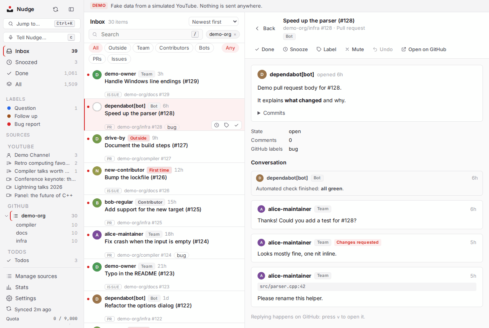

# GitHub

Nudge can follow GitHub users and organisations and put every new pull request and issue in their repositories into
the inbox, alongside YouTube comments, with who opened it, the live conversation and mute rules. It only ever reads
from GitHub, works on public repositories with no token, and takes an optional read-only token for private ones and a
higher rate limit. Back to the [README](../README.md).

Besides YouTube comments, Nudge can collect every new pull request and issue in a GitHub user's or organisation's
repositories, so you can triage them with the same keys (`e` done, `b` snooze, `m` replied).

- **Add a feed:** Sources > GitHub, enter a user or organisation (for example `octocat`). It starts "from now
  on" by default; you can also import the last two weeks or everything open. Public repositories work with no token,
  at GitHub's low anonymous rate limit.
- **Token (optional):** Settings > Connections > GitHub token. Create a **fine-grained** token (GitHub > Settings >
  Developer settings > Fine-grained tokens): resource owner = you, all repositories, and only **Issues: read-only**
  and **Pull requests: read-only**. It can also read other owners' public repositories, so one token covers your
  private repos and a public organisation. A classic token cannot be read-only for private repositories (its `repo`
  scope includes write). The token lives in Nudge's database like the YouTube key and is never sent back to the
  browser. **Test** shows who it belongs to and warns about a classic token with write-capable scopes. Nudge only reads
  from GitHub, so it needs no write access.
- **Known limitation:** there is one token for all feeds, and a fine-grained token has a single owner, so private
  repositories of a second owner (for example a private repo in an organisation) are not visible. Public ones are.
  Per-feed tokens are tracked in [#1](https://github.com/mattgodbolt/nudge/issues/1).
- **One feed per owner:** a feed covers every repository the owner has, including ones created later.
- **My accounts:** Settings > You > My GitHub accounts. Items opened by these logins (yours, and any agent account
  that works for you) never reach the inbox.
- **Who opened it:** every row says whether the author is on the team, a past contributor, a first-timer, an outsider
  or a bot, and the filter bar above the list narrows to any of those, or to just PRs or just issues.
- **Closing and coming back:** closing or merging on GitHub moves an item to Done. A Done item returns to the top of
  the inbox when someone other than you comments on it while it is open, and when it is reopened. For a pull request
  a review or inline review comment counts too (not from your accounts or a bot): when a Done PR shows an update, the
  poll asks GitHub for its reviews, one extra request per updated PR, within the same per-poll lookup cap. The chip
  says who ("New comment from @login") when Nudge looked it up.
- **The conversation:** opening an item shows its discussion under the description, fetched live with your token
  (kept a few minutes): the newest 50 comments, plus reviews and inline comments on pull requests, with replies
  that woke the item marked "New". If GitHub cannot be reached the pane says so and keeps the description. Replying
  stays on GitHub (`v` opens it).
- **Mute:** `Shift+M` mutes a repository, an author, all bots, or one item. Muted items go to All (still searchable),
  never reopen, and never notify. Rules are listed, and removable, under Sources > GitHub; the toast after muting
  offers an undo.
- **Polling:** each feed is checked about every five minutes (and on `Shift+N`), independently of YouTube's quota.
  Notifications work for GitHub arrivals too.
