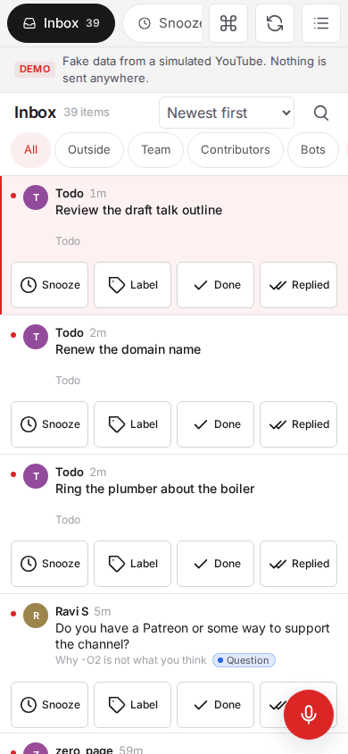

# Install on your phone and get notifications

Nudge is an installable web app (PWA) that can send Web Push notifications, with no native app involved. A phone
needs to reach it over HTTPS, which in practice means a deployment like the one in [Deploying](DEPLOYING.md). This
page covers installing it, turning notifications on per device, and how the notifications work. Back to the
[README](../README.md).

## Installing and notifications

A tab that has been in the background catches up on its own when you return to it. If a newer version was deployed
meanwhile it shows the "New version available" bar rather than reloading, so nothing half-typed is lost. You can also
refresh by hand: the circular-arrow button in the header, `Shift+R`, or pull the list down on a touch screen.

1. On the phone, open the HTTPS address in Chrome (sign in through Access if asked). Menu → **Install app**, or use the
   **Install as an app** button in **Settings > Preferences > On this device**.
2. Open **Settings > Preferences > On this device → Turn on for this device**, allow notifications, then **Send a
   test**.
3. Choose what you want: new comments and/or snoozed comments coming back. Settings are per device.

## How it works

- The server generates a VAPID key pair on first start (stored in the database) and sends each message, encrypted
  end to end, to your browser's push service (Google's FCM for Chrome). The server needs outbound HTTPS to that
  service; the phone does not need to be signed in to _receive_ a notification, only to open the page when you tap it.
- New-comment notifications are batched for ~20 seconds, so one sync is one notification ("5 new comments", or the
  comment itself if there is one). A sync only finds comments as often as it polls the YouTube API, so that is how
  fresh a notification can be. Comments older than 48 hours are never announced (a new source's history, or a slow
  video's old finds). Snooze wake-ups go out immediately.
- If Nudge is open and in view on the device, the notification is dismissed as soon as it appears (Chrome requires every
  push to show one, or it posts a generic "Tap to copy the URL for this app"). **Send a test** always stays visible.
- A device is dropped automatically when its push service says it is gone. `NUDGE_PUSH_SUBJECT` (default
  `mailto:nudge@example.invalid`) is the contact URL sent to push services; set it to a real `mailto:` if you like.
- Restoring a database backup keeps your subscriptions only if the backup is recent; otherwise a device re-registers
  itself the next time you open Settings.
