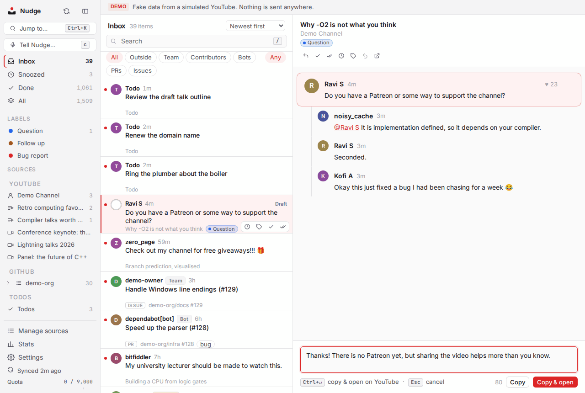

# YouTube

Nudge reads YouTube comments with your own YouTube Data API key and, if you connect a Google account, posts your
replies too; without one, a reply is copied and the comment opened on YouTube for you to paste. This page covers the
key, telling Nudge which channel is yours, both ways of replying (with the one-off Google Cloud checklist for posting
from the app), the API quota and what the API cannot do. Back to the [README](../README.md).

## Getting a key and naming your channel

YouTube comments need a YouTube Data API v3 key (free): in the [Google Cloud console](https://console.cloud.google.com/)
create a project, enable "YouTube Data API v3", and create an API key. GitHub-only use needs no YouTube key. The key is
read from `YOUTUBE_API_KEY`, then the Settings screen.
On first run, paste your channel URL or @handle when asked (or under **Settings > You > My channels**): comments by it
are never inbox items, a reply from it auto-clears older comments in the same thread, and its uploads are tracked.
Ticking "This is my channel" when adding a channel source does exactly the same thing.

## Replying

By default Nudge only has an API key, which YouTube restricts to reading. `⌘/Ctrl+Enter` in the composer then
copies your reply, opens the comment on YouTube (`&lc=` permalink) and marks it replied (`z` undoes). This hand-off
is always the fallback: it is used until you connect a Google account, and again if the sign-in lapses.

### Replying from the app (optional)

Connect your Google account and `⌘/Ctrl+Enter` posts the reply straight to YouTube (`comments.insert`, 50 quota
units) as your channel, with no copy and paste. One-time Google Cloud setup, in the same project as your API key:

1. Open https://console.cloud.google.com and pick the project that holds your YouTube API key from the project
   picker in the top bar.
2. Check that **APIs & Services > Library > YouTube Data API v3** says "Enabled". It already should be.
3. Go to **Google Auth Platform** (left menu, or search "OAuth consent"). If you see **Get started**, click it:
   - App name: `Nudge`. User support email: your address.
   - **Audience: External.** "Internal" only exists for Workspace organisations.
   - Contact email: your address. Tick the policy box, then **Create**.
4. **Data Access > Add or remove scopes.** Filter for `youtube.force-ssl`, tick `.../auth/youtube.force-ssl`
   ("See, edit, and permanently delete your YouTube videos, ratings, comments and captions"), then
   **Update > Save**. Add no other scopes.
5. **Audience > Test users > Add users.** Add the Google account that owns or manages your channel (for a Brand
   Account channel, the Google account you sign in with), then **Save**.
6. **Avoid signing in again every week:** still under **Audience**, click **Publish app > Confirm**. Status becomes
   "In production". Ignore any "needs verification" notice: an app used only by you (fewer than 100 users) is
   exempt. In "Testing" status Google expires your sign-in every 7 days and Nudge falls back to copy-and-open
   until you reconnect.
7. **Clients > Create client.** Application type **Desktop app**, name `Nudge local`, **Create**, then
   **Download JSON**. No redirect URI is needed: Nudge always uses `http://127.0.0.1:4517/api/auth/callback`
   (or your `NUDGE_PORT`).
8. Give Nudge the client in either of these ways:
   - paste the downloaded JSON into **Settings > Connections > Post replies from Nudge**;
   - set `NUDGE_GOOGLE_CLIENT_ID` and `NUDGE_GOOGLE_CLIENT_SECRET`.
9. **Settings > Connect Google account.** Choose the account, then the channel if Google asks (Brand Accounts are
   listed separately). On "Google hasn't verified this app", click **Advanced > Go to Nudge (unsafe)**: it is
   your own app. On the permissions screen, **tick the YouTube box**. Google lets you untick it, and then posting
   cannot work.
10. You are sent back to Settings showing "Connected as <channel>". `⌘/Ctrl+Enter` now posts directly.

Notes:

- **`redirect_uri_mismatch` at step 9:** your client was created as "Web application". Either recreate it as
  Desktop app, or add exactly `http://127.0.0.1:4517/api/auth/callback` under **Authorized redirect URIs**.
- **Token storage:** your refresh token lives in `data/nudge.db` (mode 600, gitignored), at the same trust level
  as the stored API key. **Disconnect** in Settings revokes it at Google and deletes it.
- Posting is a manual action, so it may use the manual quota reserve. If a post fails because the sign-in expired
  or quota ran out, the composer offers Copy & open instead; a failed post keeps your draft.
- `z` after posting only moves the original comment back to the inbox; your reply stays on YouTube. Delete it with
  the explicit **Delete reply** button on the comment.
- Replies on videos you do not own are posted as your default connected channel.
- `NUDGE_DEMO_POST=api` (with `NUDGE_DEMO=1`) fakes a connected Google account and posts into the demo data,
  for trying the flow without Google.
- On a server you reach through Cloudflare Access, the sign-in has to happen on the machine itself; see
  [Deploying](DEPLOYING.md#docker--cloudflare-access).

## Quota

The API allows 10,000 units/day. Sync is incremental and tiered by video age (hot videos every 10 min, old ones
every 48 h); the Sources screen projects daily usage and the sidebar shows today's spend. Background polling
stops at budget minus a manual reserve.

## Known limitations

Held-for-review comments are still invisible (viewing them needs OAuth reads, deferred), liking or hearting comments
is not possible through the API, editing a posted reply is not supported, and deleted comments are not detected.
